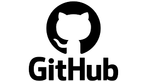
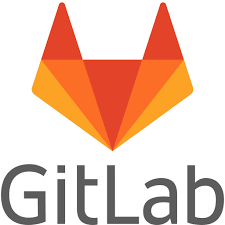
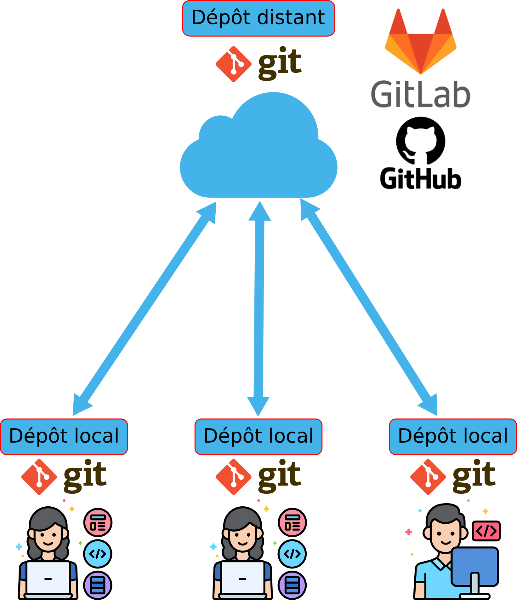
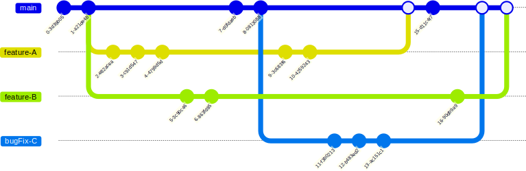

*************************************
Introduction au versionning avec git
*************************************

Git est un logiciel de gestion de versions décentralisé. C'est un logiciel libre créé par Linus Torvalds, le créateur de Linux. Il permet de suivre l'évolution d'un projet informatique en enregistrant les différentes versions des fichiers qui le composent. Git est très utilisé dans le monde du développement logiciel, mais il peut également être utilisé pour suivre l'évolution de tout type de fichier.

=============================================
Pourquoi un système de gestion de versions ?
=============================================

Les projets informatiques évoluent constamment. Il est donc important de pouvoir suivre les modifications apportées aux fichiers du projet, de revenir à des versions précédentes si nécessaire, et de collaborer efficacement avec d'autres développeurs. Un système de gestion de versions comme git permet de répondre à ces besoins.

Souvent les personnes utilisent des copies avec des noms différents pour gérer les versions de leurs fichiers, mais cette méthode est peu pratique et sujette aux erreurs. Git permet de gérer les versions de manière beaucoup plus efficace et sécurisée.

.. grid:: 1 2 2 2

   .. grid-item::

      .. grid-item-card::

         .. figure:: resources/img/old_storage_versioning_system.png
            :align: center
            :width: 100%

            Une méthode de versionnage obsolète

   .. grid-item::

      .. grid-item-card::

         .. figure:: resources/img/computer_burns.png
            :align: center
            :width: 60%

            Les ordinateurs peuvent tomber en panne, être perdus et faire perdre des données si elles ne sont pas correctement sauvegardées.

Les méthodes à proscrire à l'ère du versionnage avec git :

* Utiliser des copies multiples avec des noms différents pour gérer les versions des fichiers (zippé ou non)
* Le mail
* Les drives (google drive, dropbox, etc.)

.. list-table::
   :align: center
   :class: forbidden-methods-table

   * - ❌
     - |google_drive| |mail| |zip|

=====================================
Git permet de travailler à plusieurs
=====================================

Travailler à plusieurs implique:

👉 Travailler en parallèle sur 
  * Des éléments distincts (synchronisation)
  * Les mêmes éléments (divergences, conflits)

Git + CI/CD fournit des outils puissants pour régler ces problèmes.

Git est un système de gestion de versions (VCS, Version Control System en anglais). 
Il permet de **conserver un historique** des **modifications** effectuées sur un projet et de maintenir des **versions concurrentes** de manière **distribuée** et **synchronisée**. 

#. Identifier les modifications (quelles lignes, quand, quel auteur, commentaires, lien avec un bug, une feature)
#. Revenir à une version donnée
#. Versions de référence disponibles sur une 
   plateforme partagée (en-ligne)
#. Travailler à plusieurs et en même temps
#. Mécanismes pour **identifier et résoudre
   les conflits**

Les plateformes de gestion de versions en ligne, comme GitHub, GitLab ou Bitbucket, permettent de centraliser les dépôts git et la collaboration entre plusieurs développeurs.

.. list-table::
   :align: center
   :class: forbidden-methods-table

   * - ✅
     - |github| |gitlab|

Ces plateforme contiennent ce que l'on appelle le dépôt distant et la référence de code.

Elles permettent de:

   * Exécuter les tests d’intégration automatique
   * Créer la documentation
   * Publier la documentation officielle

Les développeurs eux:

   * Travaillent sur le code localement
   * Poussent leurs modifications vers le dépôt distant en proposant des changements (pull request)
   * Récupèrent les modifications des autres développeurs depuis le dépôt distant

.. note:: Différence entre Git & GitHub

   * Git : **logiciel** de gestion de version distribué
   * GitHub, GitLab, … : **plateformes/serveurs** d’hébergement de code source, collaboratives, web, serveurs d’exécutions pour les tests, production de la documentation, gestion de sécurité.  

   **GitHub et GitLab contiennent le même logiciel git que celui utilisé en local.**

   **NB:** on peut avoir 2 repos git en local et pusher de l’un sur l’autre

=========================
Comment fonctionne Git ?
=========================

Git stocke les différences entre les versions de votre projet sous forme de **diffs**: les différences à l'échelle des lignes des fichiers.
C'est pourquoi il est important dans le code/documentation produite que les éléments différents soient sur des lignes distinctes.
C'est pourquoi dans ce cours, nous veillerons par exemple à aller dans le restructuredText, le type de markdown utilisé pour cette documentation, à aller à la ligne à chaque nouvelle phrase.

============
Les commits
============

Un commit est un enregistrement des modifications apportées à votre dépôt git. Il permet de conserver un historique des changements et de revenir à une version précédente si nécessaire.

**RÈGLE D'OR :** chaque commit doit représenter un changement cohérent et significatif dans le projet. La modification doit être **atomique** pour que l'historique des commits reste clair et compréhensible et ne doit donc porter que sur un aspect précis du projet.

Par exemple:

   * on ne mélange pas les modifications de code avec les traductions de la documentation. On va faire 2 commits distincts pour cela.
   * on peut changer documentation et code en même temps, mais que si le changement de documentation correspond directement au changement de code.

--------------------------------------
Quels sont les fichiers à committer ?
--------------------------------------

C'est-à-dire les fichiers que l'on souhaite faire suivre par Git.

.. list-table::
   :align: center
   :class: list-comparison-ok_nok

   * - ✅
     - ❌
   * - Fichiers **texte :**

       * Code (.py, .tex, .c, etc.)
       * Configuration (.xml, .yaml, .json, etc.)
       * Fichier de projet (.toml, CMakeLists.txt, etc.)

       Fichiers **binaires de petite taille :**

       * images
       * exécutables
     - * Artefacts de compilation (.o, .pyc, etc.)
       * Tout fichier qui peut être généré rapidement, automatiquement et de manière déterministe par un processus versionné
       * CAO
       * Powerpoints
       * Vidéos
       * Datasets

=============
Les branches
=============

Les branches stockent des versions différentes et parallèle de votre projet au sein du même dépôt git. 
Elles permettent de travailler sur des fonctionnalités ou des corrections de bugs de manière isolée, sans affecter la branche principale (souvent appelée ``main`` ou ``master``).

Ainsi on a:

   * La branche principale (souvent appelée ``main`` ou ``master``) qui contient une version de **référence**: la branche «main» **utilisable** (stable)
   * Différentes versions pour différents contextes: les **releases** (types d'Os, de matériel -arm, intel, carte graphiques différentes etc. -, ainsi que différentes versions du projet)
   * Une branche de développement principale (souvent appelée ``rolling`` ou``dev``) où les nouvelles fonctionnalités et corrections de bugs sont intégrées avant d'être fusionnées dans la branche principale.

   Les différentes branches coexistent dans le dépôt git et sont utilisées pour organiser le développement du projet.

Pour que l'historique soit utilisable:

   * On ne commit jamais dans la branche principale directement. Les modifications doivent passer par une branche de développement ou une branche spécifique à une fonctionnalité.
   * Les branches de développement ou spécifiques à une fonctionnalité doivent être fusionnées dans la branche principale uniquement après avoir été testées et validées. Cette fusion se fait via une **pull request** qui si elle est acceptée est effectuée avec une commande de type ``git merge``.

Avoir un historique clair est fondamental, en pratique, on va souvent nettoyer l'historique lors du ``merge`` des branches en faisant un merge spécifique appelé **squash merge**. Cela permet de regrouper tous les commits d'une branche en un seul commit avant de l'intégrer dans la branche principale.

Exemple:

.. code-block:: bash

   git checkout -b feature-branch
   # Effectuez des modifications dans votre projet
   git add optimize.cpp
   git commit -m "[feat] new optimization feature 1"
   # Oups vous avez fait une erreur, vous la corrigez
   git add optimize.cpp
   git commit -m "[fix] fixe termination condition in optimize.cpp"
   git checkout main
   git merge --squash feature-branch
   git commit -m "[feat] new optimization feature 1"

Ainsi vous conservez un historique clair et lisible dans la branche principale, en regroupant tous les commits liés à une fonctionnalité en un seul commit et sans les péripéties intermédiaires.

La description ci-dessus est pour une utilisation locale, mais comme vous ne devriez jamais pousser des commits sur la branche principale, vous le ferez la plupart du temps sur les plateformes GitHub ou GitLab via des pull requests, dans ce cas:

  * GitHub : au moment de valider la PR, cliquez sur la flèche du bouton vert ``Merge`` et sélectionnez ``Squash and merge``.
  * GitLab : cochez la case ``Squash commits`` dans les options de la Merge Request avant de cliquer sur ``Merge``.

.. note::

   Git est souvent aussi utilisé comme un sauvegarde temporaire de votre travail, c'est normal, pour cela préfixez vos commit de sauvegarde avec ``[WIP]`` pour indiquer qu'il s'agit d'un travail en cours (Work In Progress).
   Souvent les plateformes n'effectuent pas de vérification stricte sur les commits marqués comme ``[WIP]`` et vous permettent de les pousser sur le dépôt distant sans problème.
   Vous pouvez supprimez ces commits de l'historique de votre branche en utilisant la commande``git squash``.

==================================================
Conventions de nommage, numérotation, de versions
==================================================

Choisir une convention de nommage cohérente est essentiel pour la lisibilité et la maintenabilité d'un projet, en particulier lorsque plusieurs langages de programmation coexistent, comme c'est le cas ici avec Python et C++ dans l'écosystème ROS2.

Il existe plusieurs conventions de casse (« case » en anglais), c'est-à-dire des manières de séparer les mots qui composent un nom :

* ``snake_case`` : tous les mots sont en minuscules, séparés par des underscores (``_``). Exemple : ``maximum_velocity``, ``compute_jacobian``.
* ``camelCase`` (ou *lower camel case*) : le premier mot commence par une minuscule, chaque mot suivant commence par une majuscule, sans séparateur. Exemple : ``maximumVelocity``, ``computeJacobian``.
* ``PascalCase`` (ou *upper camel case*, souvent appelé simplement ``CamelCase``) : identique au camelCase, mais le premier mot commence également par une majuscule. Exemple : ``RobotController``, ``JointState``.
* ``SCREAMING_SNAKE_CASE`` : identique au snake_case, mais tout en majuscules. Utilisé pour les constantes. Exemple : ``MAX_VELOCITY``.
* ``kebab-case`` : identique au snake_case, mais les mots sont séparés par des tirets (``-``). Peu utilisé dans le code lui-même (le tiret est souvent un opérateur), mais fréquent pour les noms de fichiers, de dépôts ou d'URL. Exemple : ``mon-super-projet``.

Ce cours retient la convention recommandée par défaut en Python (`PEP 8 <https://peps.python.org/pep-0008/#naming-conventions>`_) qui est aussi celle adoptée par la plupart des guides de style C++ utilisés en robotique (dont le `guide de style de ROS2 <https://docs.ros.org/en/rolling/Contributing/Code-Style-Language-Versions.html>`_). Elle a l'avantage d'être identique dans les deux langages, ce qui facilite le passage de l'un à l'autre :

* ``PascalCase`` pour tout ce qui désigne un **type** : classes, structures, enums, alias de types.
* ``snake_case`` pour tout ce qui désigne un **comportement** ou une **donnée** : fonctions, méthodes, variables, paramètres, champs/attributs, modules Python, espaces de noms (namespaces) C++, paquets.
* ``SCREAMING_SNAKE_CASE`` pour les **constantes** et les macros.

--------------------
Nommage de fichiers
--------------------

* Les noms de fichiers sont en ``snake_case`` et en minuscules : ``robot_controller.cpp``, ``joint_state_publisher.py``. Cela évite les problèmes de sensibilité à la casse, qui diffère suivant les systèmes de fichiers (Linux est sensible à la casse, Windows et MacOS ne le sont pas par défaut).
* On évite les espaces, les accents et les caractères spéciaux dans les noms de fichiers, qui peuvent poser des soucis suivant les terminaux, scripts ou outils de compilation utilisés.
* En C++, un fichier d'en-tête et son fichier source définissent généralement une seule classe principale, dont le nom en ``PascalCase`` est converti en ``snake_case`` pour nommer les fichiers. Par exemple la classe ``RobotController`` est déclarée dans ``robot_controller.hpp`` et définie dans ``robot_controller.cpp``.
* En Python, un module qui définit une seule classe principale suit la même règle : le module ``robot_controller.py`` contient la classe ``RobotController``.

--------------------------------------------------------------
Nommage des variables, fonctions, classes, méthodes et champs
--------------------------------------------------------------

.. list-table:: Conventions de nommage retenues pour ce cours
   :header-rows: 1
   :widths: 30 20 50

   * - Élément
     - Convention
     - Exemple
   * - Classe, structure, enum, type
     - ``PascalCase``
     - ``RobotController``, ``JointState``
   * - Fonction, méthode
     - ``snake_case``
     - ``compute_jacobian()``, ``get_position()``
   * - Variable, paramètre, champ/attribut
     - ``snake_case``
     - ``joint_velocity``, ``robot_name``
   * - Constante, macro
     - ``SCREAMING_SNAKE_CASE``
     - ``MAX_VELOCITY``, ``PI``
   * - Module (Python), espace de noms (C++), paquet
     - ``snake_case``
     - ``robot_description``, ``scara_hardware``

Quelques précisions complémentaires :

* En C++, il est courant de suffixer les attributs privés d'une classe par un underscore final (ex : ``velocity_``) afin de les distinguer visuellement des variables locales et des paramètres de fonction.
On peut aussi utiliser un préfixe ``m_`` pour les attributs membres privés (ex : ``m_velocity``) afin de les distinguer des variables locales et des paramètres de fonction.
* Python n'a pas de véritables membres privés : par convention, on préfixe par un underscore (``_velocity``) pour indiquer un usage interne à la classe ou au module, l'usage du double underscore (``__velocity``) étant réservé aux cas où l'on souhaite explicitement activer le *name mangling*.
* Un nom doit rester court mais explicite : il vaut mieux ``joint_velocity`` que ``jv`` ou que ``the_velocity_of_the_joint_in_radian_per_second``.

---------------------
Nommage des versions
---------------------

Utiliser la convention **SemVer**:

.. code-block:: text
   
   MAJEUR.MINEUR.CORRECTIF 

   * MAJEUR → rupture de compatibilité (API)
   * MINEUR → ajout compatible (Features)
   * CORRECTIF → correction de bug

Liens pour la doc: https://semver.org/lang/fr/

--------------------
Nommage des commits
--------------------

.. code-block:: bash

   <type de commit>:[<scope>] description du commit

   [optional body]

   [optional footer(s)]

   * feat: nouvelle fonctionnalité
   * fix: correction de bug
   * BREAKING CHANGE: changement API
   * docs: documentation
   * refactor: refactorisation
   * test: tests
   * build: build / dépendances
   * ci: intégration continue
   * chore: maintenance diverse

---------------------
Nommage des branches
---------------------

  * feature/<description-courte> : ajout d’une fonctionnalité
  * fix/<description-courte> : ajout d’un correctif
  * release/<version> : version du logiciel correspondant à un env. donné (API,matériel, OS, etc.)
  * chore/<description-courte> : maintenance sans impact sur l’api, les features, ou un bug
  * docs/<description-courte> : ajout d’éléments de documentation
  * hotfix/<description-courte> : ajout d’un correctif urgent

==================================================================
Identifier un problème/bug avec un système de contrôle de version
==================================================================

#. Associer le problème à un **test**
#. Trouver la première version pour laquelle le test échoue alors que le test est OK pour les versions d’avant.
#. Analyser les modifications et les appliquer itérativements pour identifier celle responsable du problème

**Procéder par dichotomie pour accélérer la recherche.**

Un outil utile pour cette recherche est la commande ``git bisect``, qui permet de procéder par dichotomie pour identifier le commit responsable d’un bug.

.. note::

   Cela ne sera efficace que si vous avez des commits atomiques |br|
      ✅ une fonction/bug/feature à la fois
   
   Cela ne marchera pas par exemple si |br|
      ❌ 50 fonctions modifiées dans le commit

========================================
Références utiles et exercices en ligne
========================================

-----------
Références
-----------

  * 👉 `www.conventionalcommits.org v1.0.0 <https://www.conventionalcommits.org/en/v1.0.0/>`_
  * 👉 `Contributing to a distributed git Project by git-scm <https://git-scm.com/book/ms/v2/Distributed-Git-Contributing-to-a-Project>`_
  * 👉 `github-flow <https://docs.github.com/en/get-started/using-github/github-flow>`_
  * 👉 `gitlab strategies for branches <https://docs.gitlab.com/user/project/repository/branches/strategies/>`_
  * 👉 `trunk-based-development by Atlassian <https://www.atlassian.com/continuous-delivery/continuous-integration/trunk-based-development>`_
  * 👉 `Spécification SemVer <https://semver.org/lang/fr/>`_

-------------------
Exercices en ligne
-------------------

Les exercices en ligne suivants sont à faire (principal et remote)

   * https://learngitbranching.js.org/?locale=fr_FR

Réaliser en cours les exercices suivants:

Principal:

   * Séquence d'introduction (1 à 4)
   * Montée en puissance (1 à 4)
   * Déplacer et indexer le travail (1 à 4)

Remote:

   * Push & Pull -- Dépôts Git distants ! (1 à 8)

Les autres exercices sont à réaliser à la maison.

================================
Règles d'or du travail avec Git
================================

   #. :text-bold-black-on-red:`Ne jamais toucher la branche «main»`
   #. :text-bold-black-on-red:`Ne jamais toucher la branche de quelqu’un d’autre`
   #. :text-bold-black-on-red:`Ne jamais ajouter tout le répertoire racine du projet` :code:`git add .`

▸ Créer une nouvelle branche (dans le repo ou sur un fork) pour chaque nouvelle fonctionnalité ou correctif |br|
▸ Faire uniquement sur cette nouvelle branche
     
     * COMMIT 
     * PUSH

============================
Initialisation du dépôt git 
============================

.. note::

   Git est un logiciel en ligne de commande. Il existe des interfaces graphiques pour Git, mais il est recommandé de commencer par apprendre à utiliser Git en ligne de commande.

À la racine de votre projet (``cd ~/info_indus/info_indus_tutorial``), initialisez un dépôt git en tapant la commande suivante:

.. code-block:: bash

   git init

Cela crée un répertoire caché ``.git`` à la racine de votre projet. Ce répertoire contient toutes les informations nécessaires pour gérer les versions de votre projet.

.. note::

   Il est important de ne pas supprimer ou modifier le répertoire ``.git``. Cela pourrait corrompre votre dépôt git.

Pour voir l'état de votre dépôt git, tapez la commande suivante:

.. code-block:: bash

   git status

Nous voyons que notre répertoire ``.vscode`` apparaît en rouge dans la section ``Untracked files``. Cela signifie que git ne suit pas les modifications de ce répertoire.

Nous emploierons souvent cette commande pour voir l'état de notre dépôt git.

Nous allons ajouter le répertoire ``.vscode`` à notre dépôt git. Pour cela, tapez la commande suivante:

.. code-block:: bash

   git add .vscode

Le répertoire ainsi que les fichiers qu'il contient sont maintenant suivis par git.
Nous pouvons voir l'état de notre dépôt git en tapant la commande suivante:

.. code-block:: bash

   git status

Nous voyons que le répertoire ``.vscode`` est ajouté par git, mais il n'est pas encore enregistré dans l'historique de git.

Pour enregistrer ces modifications dans l'historique de git, tapez la commande suivante:

.. code-block:: bash

   git commit -m "First commit"

Git ne doit pas être configuré et il vous demande de mettre des variables à jour. Faites le en suivant les instructions.

.. code-block:: bash

   git config user.email "mon.email@insa-strasbourg.fr"

.. code-block:: bash

   git config user.name "Prénom NOM"

.. note::

   L'option ``--global`` est pour que ces informations soient utilisées pour tous les projets git de votre machine, comme les machines sont partagées, il est préférable de ne pas mettre ces informations globalement, mais par projet.

Maintenant votre premier commit devrait fonctionner:

.. code-block:: bash

   git commit -m "First commit"

Cela enregistre les modifications dans l'historique de git avec le message ``First commit``.

On peut voir l'historique des commits en tapant la commande suivante:

.. code-block:: bash

   git log