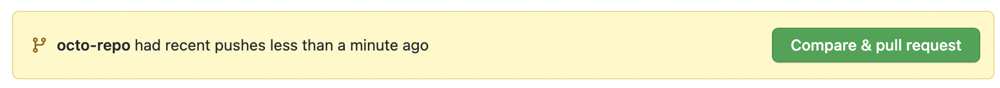
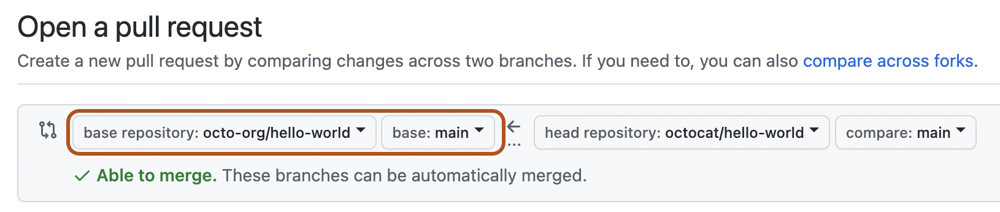
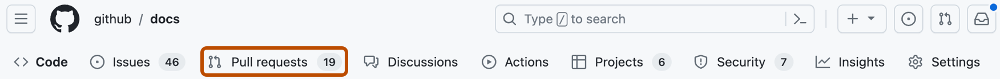
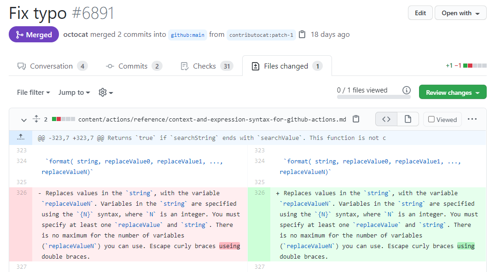

*****************************************
Coopérer grâce aux pull requests
*****************************************

.. index::
   git; pull request
   git; fork
   git; upstream
   github; pull request
   github; fork
   github; supprimer un dépôt

Jusqu'ici chacun a travaillé seul, sur **son** projet et sur **son** dépôt github.
Nous allons maintenant passer au travail en équipe : tout le groupe va contribuer à **un seul et même dépôt**, que nous appellerons le **dépôt principal**.

.. note::

   #. Créer votre groupe
   #. Dans chaque groupe, le premier qui est arrivé à ce point du cours sera le responsable du projet : c'est son projet git qui servira de base au dépôt commun du groupe, et c'est lui qui administrera le compte organisation.

Le principe du travail par pull request
=======================================

Sur un projet partagé, personne ne pousse directement sur le dépôt principal. Le cycle de travail est toujours le même :

#. chaque personne travaille dans **sa propre copie** du dépôt principal : c'est le **fork** ;
#. chaque personne travaille dans **sa propre branche** : ``mon_nom/xxxxx`` avec ``xxxxx`` décrivant le contenu ou l'objectif de la branche par exemple ``mon_nom/feature_add_option_to_save_changes_into_config_file`` ou ``mon_nom/fix_bug42`` ;
#. quand son travail est prêt, elle fait une **requête** au dépôt principal d'intégrer sa branche : c'est la **pull request** (demande de tirage) ;
#. le responsable, ainsi que toutes les personnes concernées, **lisent** la pull request, la discute, puis l'**accepte** (merge) ou la **refuse** (close).

.. note::

   Les deux mots à retenir :

   * **fork** : une copie d'un dépôt github dans **votre** compte github. Vous avez tous les droits sur votre fork, et aucun droit sur le dépôt d'origine. Github garde le lien entre les deux, c'est ce lien qui rend la pull request possible.
   * **pull request** : une demande faite au propriétaire du dépôt d'origine de **tirer** (``pull``) les commits d'une de vos branches dans une de ses branches.

Le dépôt principal n'appartiendra à personne en particulier : il appartiendra au **groupe**. Sur github cela se traduit par un compte d'un type particulier, le compte **organisation**, que le responsable va créer au nom du groupe. Le **responsable** est simplement la personne qui administre ce compte ; tous les autres sont des **membres**. Les étapes de préparation ne sont donc pas les mêmes pour tout le monde : choisissez votre onglet ci-dessous.

.. note::

   C'est ainsi que sont organisés les projets en entreprise et les grands projets libres : le dépôt de référence est rattaché à un compte organisation et non au compte personnel d'un développeur. |br|
   Cela permet de centraliser la gestion des droits et des branches sur le dépôt principal, pendant que **tout le monde** — y compris la personne qui administre l'organisation — contribue de la même manière, par fork et pull request. |br|
   Personne n'est un cas particulier, et le projet survit au départ de n'importe lequel de ses contributeurs.

Préparer le terrain
===================

.. tabs::

   .. tab:: Je suis membre (non responsable)

      Votre feuille de route :

      #. attendre que le responsable ait créé l'organisation du groupe et vous ait communiqué l'adresse du dépôt principal ;
      #. supprimer votre propre dépôt ``info_indus_tutorial`` ;
      #. forker le dépôt principal du groupe.

      Les deux dernières étapes sont détaillées ci-dessous.

      .. include:: p01s06_inc_delete_and_fork.rst.inc

   .. tab:: Je suis le responsable (une seule personne)

      Vous avez quelques étapes de plus que les autres, car c'est vous qui mettez le dépôt principal en place. Votre feuille de route :

      #. créer un compte **organisation** github au nom du groupe ;
      #. forker votre dépôt ``info_indus_tutorial`` **dans cette organisation** : ce fork devient le dépôt principal du groupe ;
      #. régler le dépôt principal pour qu'il accepte les pull requests ;
      #. communiquer l'adresse du dépôt principal à tous les membres ;
      #. puis, **exactement comme les autres membres**, supprimer votre dépôt personnel et forker le dépôt principal.

      .. rubric:: Créer un compte organisation au nom du groupe

      #. cliquez sur votre photo de profil en haut à droite, puis sur ``Your organizations`` ;

         .. figure:: resources/img/pull_request/github_docs/your_organizations_menu.png
            :align: center
            :width: 45%
            :alt: Menu du compte github ouvert, l'entrée « Your organizations » est entourée.

            L'entrée ``Your organizations`` dans le menu de votre photo de profil. |br|
            *Source : documentation officielle de GitHub (dépôt ``github/docs``, licence CC BY 4.0).*

      #. cliquez sur le bouton vert ``New organization`` ;
      #. choisissez le plan gratuit ``Free`` ;
      #. remplissez le champ ``Organization name`` avec un nom au nom de votre groupe. Ce nom doit être **unique sur tout github** et ne peut contenir ni espace ni accent : prenez par exemple ``info-indus-groupe-01`` ;
      #. renseignez le ``Contact email`` et indiquez, à la question ``This organization belongs to``, qu'il s'agit d'un compte personnel (``My personal account``) ;
      #. validez. Github vous propose alors d'inviter des membres : saisissez les logins github des autres membres du groupe, ou passez l'étape avec ``Skip this step``.

      .. note::

         Inviter les membres dans l'organisation n'est **pas** nécessaire pour qu'ils puissent forker le dépôt et ouvrir des pull requests : un dépôt public est forkable par n'importe qui. L'invitation sert à autre chose : elle permettra plus tard de donner à certains membres le droit de relire et d'intégrer les pull requests des autres, au lieu que tout repose sur vous.

      .. rubric:: Forker votre dépôt dans l'organisation

      C'est le moment de transférer votre travail au groupe. Vous n'allez pas déplacer votre dépôt, vous allez en faire un fork dans l'organisation : votre dépôt personnel reste intact pour l'instant.

      #. allez sur la page de votre dépôt ``info_indus_tutorial`` sur github ;
      #. cliquez sur le bouton ``Fork``, en haut à droite de la page ;

         .. figure:: resources/img/pull_request/github_docs/fork_button.png
            :align: center
            :width: 80%
            :alt: Page d'accueil d'un dépôt github, le bouton « Fork » est entouré.

            Le bouton ``Fork``, dans la barre de boutons en haut à droite de la page du dépôt. |br|
            *Source : documentation officielle de GitHub (dépôt ``github/docs``, licence CC BY 4.0).*

      #. dans la page ``Create a new fork``, ouvrez la liste déroulante ``Owner`` et sélectionnez **l'organisation du groupe** que vous venez de créer, et non votre login personnel ;
      #. laissez le champ ``Repository name`` sur ``info_indus_tutorial`` ;
      #. **décochez** la case ``Copy the rolling branch only`` : nous voulons aussi récupérer la branche ``gh-pages`` ;
      #. cliquez sur le bouton ``Create fork``.

      Le dépôt ``mon_groupe/info_indus_tutorial`` ainsi créé est désormais le **dépôt principal du groupe**.

      .. rubric:: Autoriser les pull requests sur le dépôt principal

      Tous les réglages qui suivent se font sur le dépôt **de l'organisation**, pas sur votre dépôt personnel. Les réglages d'un dépôt ne sont pas recopiés par le fork : il faut les refaire.

      #. allez sur la page du dépôt ``mon_groupe/info_indus_tutorial`` ;
      #. cliquez sur l'onglet ``Settings``, sous-section ``General`` ;
      #. dans la section ``Features``, vérifiez que la case ``Issues`` est cochée : c'est là que se feront les discussions ;
      #. descendez jusqu'à la section ``Pull Requests`` et cochez au moins ``Allow merge commits`` ainsi que ``Allow squash merging`` ;
      #. cochez également ``Automatically delete head branches`` : github supprimera les branches une fois les pull requests intégrées, cela évite d'accumuler des branches mortes.

      .. note::

         Un dépôt **public** accepte les pull requests venant de n'importe quel fork sans réglage particulier : il n'y a pas de case ``Allow pull requests`` à cocher. Ce qui se règle ici, c'est **comment** les pull requests pourront être intégrées. Vérifiez simplement, dans la ``Danger Zone`` tout en bas de la page ``General``, que le dépôt est bien ``public`` : s'il était privé, personne ne pourrait le forker.

         .. figure:: resources/img/pull_request/allow_pull_requests.gif
            :align: center
            :width: 80%

      .. note::

         Pour que la documentation du groupe soit publiée comme l'était la vôtre, il reste deux choses à refaire sur le dépôt de l'organisation : |br|
         1. rejouer :ref:`le réglage des actions github<setup_git_actions>` (``Settings`` → ``Actions`` → ``General``), car un fork ne recopie pas ces autorisations ; |br|
         2. corriger dans le fichier ``.github/workflows/documentation.yml`` la ligne ``git clone ...``, qui pointe encore vers votre dépôt personnel, pour qu'elle pointe vers l'adresse ``HTTPS`` du dépôt de l'organisation. |br|
         Faites ce second point plus tard, par une pull request : ce sera votre première contribution au dépôt du groupe.

      .. rubric:: Communiquer l'adresse du dépôt principal à tous les membres

      Sur la page d'accueil du dépôt de l'organisation, cliquez sur le bouton vert ``Code`` et copiez l'adresse ``HTTPS`` (voir la :ref:`procédure du chapitre précédent <get_git_remote_project_address>`), puis diffusez-la au groupe. Elle est de la forme :

      .. code-block:: text

         https://github.com/mon_groupe/info_indus_tutorial

      .. note::

         Diffusez l'adresse ``HTTPS`` et non l'adresse ``ssh`` : l'adresse ``HTTPS`` est celle que l'on ouvre dans un navigateur pour forker le dépôt. Chaque membre utilisera ensuite l'adresse ``ssh`` de **son propre fork** pour le cloner.

      .. rubric:: Et maintenant, comme tout le monde

      Le dépôt principal existe et il est en place. Vous redevenez à cet instant un contributeur comme les autres : votre dépôt personnel ``info_indus_tutorial`` fait double emploi avec celui de l'organisation, vous allez donc le supprimer, puis forker le dépôt principal — autrement dit reforker chez vous ce que vous venez de forker dans l'organisation.

      .. include:: p01s06_inc_delete_and_fork.rst.inc

À partir d'ici, **tout le monde fait exactement la même chose** : responsable comme membres, chacun possède son fork personnel du dépôt principal et travaille dedans.

Cloner son fork
===============

Récupérez l'adresse ``ssh`` de **votre fork** (bouton vert ``Code`` sur la page de votre fork, onglet ``SSH``), exactement comme au chapitre précédent, puis clonez-le :

.. code-block:: bash

   cd ~/info_indus

.. code-block:: bash

   git clone MY_FORK_SSH_ADDRESS info_indus_tutorial

Remplacez ``MY_FORK_SSH_ADDRESS`` par l'adresse ``ssh`` de votre fork. Elle est de la forme ``git@github.com:mon_login/info_indus_tutorial.git``.

.. warning::

   Clonez bien **votre fork**, et non le dépôt principal. Si vous clonez le dépôt principal, vous ne pourrez rien y pousser : vous n'avez pas les droits en écriture dessus.

Placez-vous dans le dépôt et vérifiez où pointe ``origin`` :

.. code-block:: bash

   cd ~/info_indus/info_indus_tutorial

.. code-block:: bash

   git remote -v

Vous devez voir votre fork, et lui seul.

.. note::

   Par convention, on ajoute un second dépôt distant nommé ``upstream`` qui pointe vers le dépôt principal. Il sert plus tard à récupérer le travail des autres une fois qu'il a été intégré :

   .. code-block:: bash

      git remote add upstream https://github.com/mon_groupe/info_indus_tutorial.git

   ``origin`` est à vous et vous pouvez y pousser ; ``upstream`` ne vous appartient pas et vous n'en ferez que des ``git fetch`` / ``git pull``.

Créer sa branche personnelle
============================

On ne travaille jamais directement sur ``rolling`` : c'est la branche de référence, celle qui doit toujours fonctionner. Chacun crée donc sa branche de travail, nommée par exemple ``mon_nom/dev``.

Vérifiez d'abord sur quelle branche vous êtes :

.. code-block:: bash

   git branch -a

Créez ensuite votre branche à partir de ``rolling`` :

.. code-block:: bash

   git switch -c mon_nom/dev

Remplacez ``mon_nom`` par **votre** nom ou votre login github, sans espace ni accent : par exemple ``yguel/dev``.

.. note::

   Le caractère ``/`` dans ``yguel/dev`` n'est pas un répertoire : git autorise les ``/`` dans les noms de branche et les outils s'en servent pour **regrouper** les branches par préfixe. C'est la convention la plus répandue : ``nom/dev``, ``nom/fix-truc``, ``feature/machin``. Elle rend la liste des branches lisible dès que le projet grossit.

Vérifiez que vous êtes bien sur votre nouvelle branche :

.. code-block:: bash

   git branch -a

L'étoile ``*`` doit se trouver devant ``mon_nom/dev``.

Pousser sa branche sur son fork
===============================

Votre branche n'existe pour l'instant que sur votre machine. Poussez-la sur votre fork :

.. code-block:: bash

   git push -u origin mon_nom/dev

Comme au chapitre précédent, l'option ``-u`` n'est nécessaire que la **première** fois que vous poussez cette branche : elle associe votre branche locale à la branche distante du même nom. Ensuite, un simple ``git push`` suffira.

Rafraîchissez la page de votre fork sur github : le sélecteur de branches, en haut à gauche de la liste des fichiers, affiche maintenant deux branches, ``rolling`` et ``mon_nom/dev``.

Faire une modification personnelle
==================================

Chacun va maintenant faire une modification **différente de celle des autres**, pour que les pull requests soient bien distinctes.

Éditez le fichier ``doc/sphinx/source/index.rst`` et ajoutez-y une ligne contenant votre prénom et votre nom, par exemple :

.. code-block:: text

   Cette ligne a été ajoutée par Manuel YGUEL.

Puis enregistrez le travail et poussez-le :

.. code-block:: bash

   git add doc/sphinx/source/index.rst

.. code-block:: bash

   git commit -m "Add a line signed by MY_NAME in the main index"

.. code-block:: bash

   git push

Remplacez ``MY_NAME`` par votre nom. Notez qu'il n'y a plus besoin de l'option ``-u`` : la branche est déjà associée.

Ouvrir une pull request
=======================

Allez sur la page de **votre fork** sur github et rafraîchissez-la. Github détecte que vous venez de pousser une branche et affiche, juste au-dessus de la liste des fichiers, un bandeau jaune avec un bouton vert ``Compare & pull request``.

#. cliquez sur le bouton ``Compare & pull request`` ;
#. github ouvre la page ``Open a pull request``. Vérifiez les quatre champs de la ligne de comparaison, en haut :

   #. ``base repository`` : le dépôt **principal**, ``mon_groupe/info_indus_tutorial`` ;
   #. ``base`` : la branche ``rolling`` du dépôt principal, c'est là que vous demandez à être intégré ;
   #. ``head repository`` : **votre** fork ;
   #. ``compare`` : **votre** branche ``mon_nom/dev`` ;

#. donnez un titre clair à la pull request, par exemple ``Ajout de la signature de Manuel YGUEL`` ;
#. écrivez dans le champ de description ce que vous avez modifié et pourquoi ;
#. cliquez sur le bouton vert ``Create pull request``.

.. note::

   Si le bandeau jaune a disparu (il ne s'affiche que quelques minutes après le ``push``), le chemin complet fonctionne toujours : sur la page de votre fork, cliquez sur l'onglet ``Pull requests``, puis sur le bouton vert ``New pull request``, et renseignez les quatre champs ci-dessus.

   Le bandeau qui apparaît sur votre fork juste après le ``push``, avec le bouton ``Compare & pull request``. |br|
   *Source : documentation officielle de GitHub (dépôt ``github/docs``, licence CC BY 4.0).*

   La ligne de comparaison de la page ``Open a pull request``. Ici ``base repository`` est le dépôt d'une organisation (``octo-org``) et ``head repository`` le fork personnel (``octocat``) : c'est exactement votre situation. |br|
   *Source : documentation officielle de GitHub (dépôt ``github/docs``, licence CC BY 4.0).*

..
   CAPTURE D'ÉCRAN ENCORE À RÉALISER (aucune image officielle n'existe) puis
   décommenter le bloc ci-dessous :
   - create_pull_request_03.png : le bouton ``New pull request`` de l'onglet
     ``Pull requests`` (chemin de secours décrit dans la note ci-dessus)

   .. figure:: resources/img/create_pull_request_03.png
      :align: center
      :width: 80%

Votre pull request est maintenant ouverte **sur le dépôt principal**. Vous n'avez pourtant aucun droit d'écriture dessus : c'est tout l'intérêt du mécanisme. Vous avez **proposé** une modification, vous ne l'avez pas imposée.

Voir les pull requests de tout le monde
=======================================

Attendez que chaque membre du groupe ait ouvert la sienne, puis :

#. ouvrez l'adresse du **dépôt principal** communiquée par le responsable ;
#. cliquez sur l'onglet ``Pull requests``, en haut de la page. Le compteur à côté du nom de l'onglet indique le nombre de pull requests ouvertes ;
#. vous voyez la liste de **toutes** les pull requests du groupe, avec pour chacune son numéro (``#1``, ``#2``, ...), son titre, son auteur et sa date ;
#. cliquez sur l'une d'elles, puis sur l'onglet ``Files changed`` : vous voyez le ``diff``, ligne par ligne, exactement comme avec ``git diff`` ;
#. revenez sur l'onglet ``Conversation`` : c'est là que se discute la modification. Tout le monde peut commenter, y compris dans la marge d'une ligne précise du ``diff``.

   L'onglet ``Pull requests`` du dépôt principal, et son compteur de pull requests ouvertes. |br|
   *Source : documentation officielle de GitHub (dépôt ``github/docs``, licence CC BY 4.0).*

   Une pull request, ouverte sur son onglet ``Files changed`` : le ``diff`` est affiché ligne à ligne, en rouge ce qui est retiré, en vert ce qui est ajouté. Les onglets ``Conversation``, ``Commits``, ``Checks`` et ``Files changed`` sont visibles en haut. |br|
   *Source : documentation officielle de GitHub (dépôt ``github/docs``, licence CC BY 4.0).*

Retenez bien ce point : **tout le travail proposé est visible par tous, avant d'être intégré**. C'est ce qui rend la relecture par les pairs possible, et c'est la raison d'être des pull requests.

Refuser toutes les pull requests
================================

.. note::

   Cette partie se fait en groupe. |br|
   Quand on travaille à distance, on peut faire en sorte que plusieurs personnes autorisées soient nécessaire pour valider une pull request avant qu'elle ne soit intégrée. |br|
   Cela permet de garantir que le code est relu et approuvé par plusieurs membres du groupe avant d'être fusionné. |br| |br|

   L'option sous github se trouve dans les **Settings** du dépôt principal, sous **Branches**, puis en configurant les **branch protection rules** pour la branche ``rolling``.
   Il faut choisir le nombre de relecteurs obligatoires et éventuellement d'autres critères de protection de la branche.

   Dans notre cas particulier, réunissez vous autour du responsable.

Ces pull requests n'étaient qu'un exercice : nous allons maintenant toutes les refuser, pour voir ce que cela donne et pour laisser le dépôt principal propre.

Sur github, refuser une pull request se dit **fermer** (``close``) : on ne la supprime pas, on la clôt sans l'intégrer. Elle reste consultable, avec toute sa discussion, dans le filtre ``Closed``.

Le responsable, pour chaque pull request ouverte :

#. ouvrez le dépôt principal, onglet ``Pull requests`` ;
#. cliquez sur la première pull request de la liste ;
#. descendez tout en bas de l'onglet ``Conversation``, jusqu'au champ de commentaire ;
#. écrivez un commentaire expliquant le refus, par exemple ``Merci, c'était un exercice : je ferme cette pull request sans l'intégrer.`` ;
#. cliquez sur le bouton ``Close with comment`` (si vous n'écrivez rien, le bouton s'appelle simplement ``Close pull request``) ;
#. recommencez pour chacune des autres pull requests.

..
   CAPTURES D'ÉCRAN ENCORE À RÉALISER puis décommenter le bloc ci-dessous.
   La documentation officielle de GitHub ne fournit aucune image pour cette
   étape, il faut donc les prendre soi-même (ou les enregistrer en gif, comme
   les trois animations de la section « Préparer le terrain ») :
   - close_pull_request_01.png : le bas de l'onglet ``Conversation`` avec le commentaire saisi et le bouton ``Close with comment``
   - close_pull_request_02.png : la pull request fermée (état ``Closed``) et le filtre ``Closed`` de la liste

   .. figure:: resources/img/close_pull_request_01.png
      :align: center
      :width: 80%

   .. figure:: resources/img/close_pull_request_02.png
      :align: center
      :width: 80%

Une fois toutes les pull requests fermées, retournez sur l'onglet ``Pull requests`` du dépôt principal : le compteur ``Open`` est à zéro, et le filtre ``Closed`` les contient toutes.

.. note::

   Fermer une pull request ne touche **ni** à votre fork **ni** à votre branche ``mon_nom/dev`` : votre travail est toujours là, chez vous. Une pull request fermée peut d'ailleurs être rouverte avec le bouton ``Reopen pull request``, et pousser un nouveau commit sur la branche ``mon_nom/dev`` d'une pull request **ouverte** la met automatiquement à jour. C'est ainsi qu'on corrige un travail après une relecture : on ne referme pas une pull request pour en ouvrir une autre, on pousse les corrections sur la même branche.

.. note::

   Les captures d'écran fixes de cette section proviennent de la documentation officielle de GitHub, publiée dans le dépôt `github/docs <https://github.com/github/docs>`_ sous licence `CC BY 4.0 <https://github.com/github/docs/blob/main/LICENSE>`_. |br|
   Le détail fichier par fichier se trouve dans ``resources/img/pull_request/github_docs/CREDITS.txt``. |br|
   Les noms de dépôts et de comptes qu'on y voit (``octocat``, ``octo-org``, ``hello-world``, ``github/docs``) sont ceux des exemples de GitHub : transposez-les à votre fork, à votre organisation et à ``info_indus_tutorial``.

Commencez à collaborer !
=========================

Chacun d'entre vous peut maintenant docummenter les équations de la dynamique du système 5 barres (voir :ref:`mechanical_description`) dans votre fork du projet, en créant ou en modifiant les fichiers appropriés et en soumettant vos changements via des pull requests.

Écrire la dynamique c'est écrire les équations donnant la position de la pointe du stylo en fonction des angles des articulations du système 5 barres: :math:`q_1, q_4`.

Attention, pour avoir une unique solution il faut faire attention à la configuration initiale du système et ajouter des contraintes géométriques pour contraindre certains mouvements.
