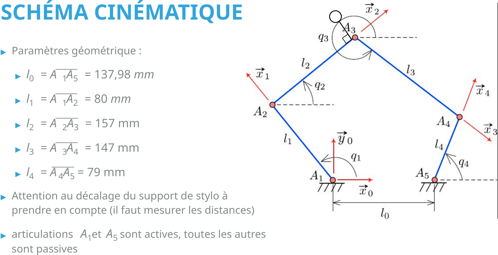

.. _write_tests_with_gtest:

##########################################
Écrire des tests C++ avec Google Test
##########################################

.. index:: Google Test, gtest, test unitaire, TDD

Un test unitaire est un morceau de code dont le seul rôle est de **vérifier automatiquement** qu'un autre morceau de code fait ce qu'il doit faire.
Tant qu'une vérification n'est pas écrite sous forme de test exécutable, elle n'existe pas : elle est au mieux dans la tête de celui qui a écrit le code, et elle disparaît à la première modification.

Dans ce chapitre, nous utilisons un projet support complet : la simulation du **système 5 barres** du cours, dans lequel les **modèles géométriques direct et inverse** sont à écrire, et où les tests sont déjà fournis.

.. note::

   Les sections :doc:`p03s03_write_tests_for_python` et :doc:`p03s04_use_simulation_to_write_tests` reprennent le même projet, respectivement en Python et du point de vue de la simulation.
   La section :doc:`p03s05_create_CI_for_automatically_runing_your_tests` montre comment faire exécuter ces tests automatiquement à chaque ``push``.

******************************
Le projet support : 5 barres
******************************

Le projet est un espace de travail ROS 2 fourni avec le cours, dans le dossier ``mujoco/five_bars_ws`` du dépôt.
Il simule le système 5 barres étudié en travaux pratiques (voir :ref:`mechanical_description`).

Première étape, commune à tout le monde : récupérer le dépôt du cours et se placer dans l'espace de travail.

.. code-block:: bash

   git clone https://github.com/yguel/informatique_industrielle_avec_ROS2.git
   cd informatique_industrielle_avec_ROS2/mujoco/five_bars_ws

   Schéma cinématique du système 5 barres. Les deux moteurs imposent les angles absolus ``q1`` (bras gauche ``A1A2``) et ``q4`` (bras droit ``A5A4``) ; la chaîne se referme en ``A3`` ; le stylo est porté par l'avant-bras gauche, **décalé** par rapport à ``A3``.

Les paquets utiles pour ce chapitre sont :

.. list-table::
   :header-rows: 1
   :widths: 30 70

   * - Paquet
     - Rôle
   * - ``five_bars_description``
     - Géométrie du robot : ``config/geometry.yaml``, modèle MuJoCo (MJCF) et URDF générés à partir de ce fichier.
   * - ``five_bars_mujoco``
     - Simulation MuJoCo (``sim.py``) et nœuds ROS 2 (simulateur, IHM, mise à jour d'état).
   * - ``five_bars_kinematics``
     - **Le code à écrire** (modèles direct et inverse, en C++ et en Python) **et ses tests** (``gtest`` et ``unittest``).

Le code à écrire est volontairement livré vide : seules les signatures et les conventions sont données.

.. literalinclude:: resources/code/five_bars/kinematics/include/kinematics.hpp
   :language: cpp
   :lines: 29-61
   :caption: ``five_bars_kinematics/include/five_bars_kinematics/kinematics.hpp`` — les structures et les deux fonctions à implémenter

.. literalinclude:: resources/code/five_bars/kinematics/src/kinematics.cpp
   :language: cpp
   :caption: ``five_bars_kinematics/src/kinematics.cpp`` — l'état initial du code à écrire

L'objectif de cette section n'est pas d'écrire ces deux fonctions, mais de comprendre **les tests qui les jugent**.

.. _five_bars_installation:

Installer l'environnement
=========================

Le projet a besoin de **ROS 2 Jazzy** et de **MuJoCo 4.0.1**. Il y a deux façons de les obtenir :

* **avec Docker** : rien à installer sur votre machine à part Docker, l'image contient ROS 2, MuJoCo et Google Test. C'est la méthode **recommandée**, et c'est exactement ce que fait l'intégration continue du projet.
* **sans Docker** : installation native. Elle n'a de sens que sur **Ubuntu 24.04** (*Noble*), la seule distribution pour laquelle ROS 2 Jazzy est distribué en paquets binaires.

.. dropdown:: Comment installer Docker sur votre machine si besoin ?

   .. tab-set::

      .. tab-item:: Installer Docker sur Linux

         Suivez les instructions officielles : `installer Docker Engine <https://docs.docker.com/engine/install/>`_ (pour Ubuntu : `installer Docker Engine sur Ubuntu <https://docs.docker.com/engine/install/ubuntu/>`_).

         Ajoutez ensuite votre compte au groupe ``docker``, sans quoi il faudra préfixer chaque commande par ``sudo`` :

         .. code-block:: bash

            sudo usermod -aG docker $USER

         Fermez puis rouvrez votre session (le changement de groupe n'est pris en compte qu'à la connexion), et vérifiez :

         .. code-block:: bash

            docker run --rm hello-world

         Voir aussi les `étapes post-installation <https://docs.docker.com/engine/install/linux-postinstall/>`_ de la documentation Docker.

      .. tab-item:: Installer Docker sur Windows

         Installez `Docker Desktop pour Windows <https://docs.docker.com/desktop/setup/install/windows-install/>`_, en choisissant le moteur **WSL 2** (c'est le choix par défaut).

         Puis, dans ``Settings`` → ``Resources`` → ``WSL integration``, activez l'intégration pour votre distribution ``Ubuntu-24.04``. La commande ``docker`` devient alors utilisable **depuis le terminal Ubuntu de WSL**, ce qui est ce dont nous avons besoin.

         Vérifiez depuis le terminal Ubuntu :

         .. code-block:: bash

            docker run --rm hello-world

      .. tab-item:: Installer Docker sur Mac

         Installez `Docker Desktop pour Mac <https://docs.docker.com/desktop/setup/install/mac-install/>`_, en prenant la version correspondant à votre processeur (Apple Silicon ou Intel).

         Vérifiez dans un terminal :

         .. code-block:: bash

            docker run --rm hello-world

Choisissez maintenant l'onglet qui correspond à votre machine.

.. tab-set::
   :sync-group: five-bars-env

   .. tab-item:: Linux avec Docker
      :sync: linux-docker

      C'est la configuration de référence : celle des machines de la salle de cours, et celle de l'intégration continue.

      Tout passe par un seul script, ``docker/start.sh``, qui construit l'image au premier appel (comptez une dizaine de minutes) :

      .. code-block:: bash

         docker/start.sh test     # compile et lance tous les tests, headless

      Les autres usages du script :

      .. code-block:: bash

         docker/start.sh                                        # un shell dans le conteneur, workspace compilé
         docker/start.sh --rebuild                              # forcer la reconstruction de l'image
         docker/start.sh ros2 run five_bars_mujoco direct_gui   # lancer une seule commande

      .. note::

         Quelques propriétés utiles du script :

         * le dossier ``src/`` de votre machine est **monté** dans le conteneur (``/ws/src``) : vous éditez le code avec votre éditeur habituel, sur votre machine, et vous compilez dans le conteneur ;
         * l'affichage graphique est géré automatiquement (le script appelle ``xhost +local:docker`` et passe votre ``DISPLAY``) : le viewer MuJoCo et RViz s'ouvrent comme des fenêtres normales ;
         * si une carte graphique est disponible (``/dev/dri``), elle est passée au conteneur ;
         * un second appel à ``docker/start.sh``, pendant que le conteneur tourne, ouvre simplement **un deuxième shell** dedans.

   .. tab-item:: Linux sans Docker
      :sync: linux-native

      .. warning::

         Cette installation n'est valable que sur **Ubuntu 24.04** (*Noble*). ROS 2 Jazzy n'est distribué en paquets binaires que pour cette version. Sur une autre distribution ou une autre version d'Ubuntu, utilisez Docker.

      .. rubric:: 1. Installer ROS 2 Jazzy

      Suivez la procédure officielle : `installation de ROS 2 Jazzy par paquets Debian <https://docs.ros.org/en/jazzy/Installation/Ubuntu-Install-Debs.html>`_, puis :

      .. code-block:: bash

         sudo apt install ros-jazzy-ros-base python3-colcon-common-extensions

      .. rubric:: 2. Installer les dépendances du projet

      Ce sont exactement celles de l'image Docker (voir ``docker/Dockerfile``) :

      .. code-block:: bash

         sudo apt install -y \
           build-essential cmake git python3-pip python3-numpy python3-yaml python3-pytest python3-tk \
           googletest libgtest-dev libgmock-dev \
           ros-jazzy-ament-cmake-gtest ros-jazzy-ament-cmake-pytest \
           ros-jazzy-ros2-control ros-jazzy-ros2-controllers ros-jazzy-xacro \
           ros-jazzy-robot-state-publisher ros-jazzy-tf2-ros-py \
           libgl1 libegl1 libglfw3 libosmesa6

      Ajoutez ``ros-jazzy-rviz2`` si vous voulez visualiser le robot dans RViz.

      .. rubric:: 3. Installer MuJoCo

      .. code-block:: bash

         pip3 install --break-system-packages "mujoco==4.0.1"

      .. note::

         Deux points méritent une explication.

         ``--break-system-packages`` est nécessaire parce qu'Ubuntu 24.04 protège les paquets Python du système (`PEP 668 <https://peps.python.org/pep-0668/>`_). Un environnement virtuel serait plus propre, mais il complique l'usage de ``colcon``, qui s'attend à trouver les paquets Python de ROS 2. |br|
         La **même** roue pip fournit MuJoCo pour Python **et** la bibliothèque C utilisée par les tests gtest : Python et C++ utilisent ainsi strictement la même version. C'est le fichier ``cmake/FindMuJoCo.cmake`` du projet qui la localise, en interrogeant le module Python. Vous n'avez donc rien à configurer ; la variable ``MUJOCO_DIR`` ne sert que si vous préférez une archive officielle de MuJoCo.

      Vérifiez l'installation :

      .. code-block:: bash

         python3 -c "import mujoco, os; print(mujoco.__version__, os.path.dirname(mujoco.__file__))"

      .. rubric:: 4. Compiler et lancer les tests

      .. code-block:: bash

         ros2_jazzy
         ros2_build_reldebug
         ros2_test
         ros2_view_tests

      .. note::

         Ce sont les raccourcis du cours, définis dans le ``~/.bashrc`` présenté au
         :doc:`chapitre 2 <../c02_first_ros2_project_pimped/p02s01_pimped_pubsub>` et
         détaillés dans :doc:`p03s01_run_ros2_tests`. ``ros2_jazzy`` remplace
         ``source /opt/ros/jazzy/setup.bash`` et reste à relancer dans **chaque**
         nouveau terminal ; ``ros2_build_reldebug`` enchaîne ``rosdep install``, la
         compilation en ``RelWithDebInfo`` et ``source install/setup.bash``. |br|
         Ils sont déjà chargés dans le conteneur Docker. En installation native,
         installez ce ``~/.bashrc`` une fois pour toutes.

   .. tab-item:: Raspberry Pi 5 sans Docker
      :sync: rpi5

      Sur un Raspberry Pi 5 sous **Ubuntu 24.04 pour arm64**, l'installation native fonctionne : ROS 2 Jazzy est publié pour ``arm64``, et MuJoCo fournit des roues ``aarch64``.

      Reprenez **à l'identique** les quatre étapes de l'onglet « Linux sans Docker », compilation comprise :

      .. code-block:: bash

         ros2_jazzy
         ros2_build_reldebug

      Deux précautions s'ajoutent, propres au Pi.

      .. rubric:: Si la compilation se fait tuer

      ``colcon`` compile tous les paquets en parallèle. Avec les 8 Go d'un Pi 5 cela passe, mais sur un modèle 4 Go le compilateur peut se faire tuer par le noyau, et la compilation échoue sur un message peu clair. Dans ce cas seulement, laissez le raccourci de côté et bridez le parallélisme :

      .. code-block:: bash

         colcon build --parallel-workers 2 --cmake-args -DCMAKE_BUILD_TYPE=RelWithDebInfo --symlink-install
         source install/setup.bash

      Ajoutez aussi un fichier d'échange (``swap``) d'au moins 2 Go avant de compiler.

      .. rubric:: Rendu logiciel

      Le Pi n'a pas de pilote OpenGL utilisable par MuJoCo pour le rendu hors écran. Forcez le rendu logiciel, fourni par ``libosmesa6`` :
      
      Ajoutez cette ligne à votre ``~/.bashrc``. 

      .. code-block:: bash

         export MUJOCO_GL=osmesa

      .. rubric:: Le viewer 3D

      .. code-block:: bash

         ros2 run five_bars_mujoco direct_gui

      .. tip::

         Si l'affichage devient poussif chez vous, deux portes de sortie, dans cet ordre :

         1. la version **sans fenêtre de rendu** — les curseurs restent, la simulation tourne derrière, et c'est amplement suffisant pour manipuler ``q1`` et ``q4`` :

            .. code-block:: bash

               ros2 run five_bars_mujoco direct_gui --no-viewer
         
         2. **une machine plus puissante**, dans une approche industrielle, les single board computers comme le Raspberry Pi sont utilisés pour exécuter les nœuds ROS 2, mais le développement et la compilation et le rendu 3D se font sur des machines plus performantes. |br|
         Néanmoins pour ce cours, le Pi 5 est normalement suffisant pour exécuter les nœuds ROS 2 et la simulation, même avec le rendu 3D.

   .. tab-item:: Windows avec WSL 2
      :sync: windows-wsl

      Sous Windows, on ne travaille pas directement dans Windows : on installe **WSL 2** (une vraie Ubuntu dans Windows), et tout le reste se fait depuis le terminal Ubuntu.

      .. rubric:: 1. Installer WSL 2 avec Ubuntu 24.04

      Dans un terminal PowerShell **en administrateur** :

      .. code-block:: powershell

         wsl --install -d Ubuntu-24.04

      Redémarrez, puis ouvrez ``Ubuntu-24.04`` depuis le menu Démarrer et créez votre compte Linux. La procédure détaillée est celle de Microsoft : `installer WSL <https://learn.microsoft.com/en-us/windows/wsl/install>`_. Le :doc:`chapitre 1 <../c01_create_and_publish_doc/p01s02_create_and_publish_doc>` en donne aussi une version pas à pas.

      .. warning::

         Clonez le dépôt dans le système de fichiers **de Linux** (sous ``~/``), et surtout **pas** dans ``/mnt/c/...``. Les accès de WSL aux disques Windows sont très lents — une compilation peut prendre plusieurs fois plus de temps — et les permissions de fichiers n'y sont pas respectées, ce qui perturbe git et Docker.

      .. rubric:: 2. Puis, au choix

      À partir de ce point, votre terminal Ubuntu est un Linux ordinaire, et les deux autres onglets s'appliquent **mot pour mot** :

      * **avec Docker** (recommandé) : installez Docker Desktop en activant l'intégration WSL (voir le dépliant « Comment installer Docker » ci-dessus), puis suivez l'onglet « Linux avec Docker » ;
      * **sans Docker** : votre WSL *est* une Ubuntu 24.04, donc l'onglet « Linux sans Docker » s'applique tel quel.

      .. note::

         Sous Windows 11, WSL affiche les fenêtres graphiques Linux sans configuration (WSLg) : le viewer MuJoCo et RViz s'ouvrent comme des applications Windows. Le rendu est logiciel par défaut, donc lent mais utilisable.

   .. tab-item:: macOS
      :sync: macos

      Sur Mac, **Docker est la seule voie raisonnable** : ROS 2 Jazzy n'est pas distribué en binaire pour macOS, il faudrait le compiler depuis les sources, ce qui dépasse largement le cadre de ce cours.

      Installez Docker Desktop (voir le dépliant ci-dessus), puis :

      .. code-block:: bash

         docker/start.sh test

      Cela fonctionne sur Apple Silicon comme sur Intel : l'image est une image Linux, et MuJoCo y est installé pour Linux.

      .. warning::

         Deux limites, propres à Docker Desktop et non au projet :

         #. macOS n'a pas de serveur X11, donc ``docker/start.sh`` détecte l'absence de ``DISPLAY`` et bascule en mode *headless* : **les tests tournent, mais aucune fenêtre ne s'ouvre**. Pour obtenir le viewer 3D, installez `XQuartz <https://www.xquartz.org/>`_, cochez « Allow connections from network clients » dans ses préférences, puis lancez ``xhost + 127.0.0.1`` et exportez ``DISPLAY=host.docker.internal:0`` avant d'appeler le script.
         #. l'option ``--network host`` n'existe pas sur Docker Desktop. Les nœuds ROS 2 **à l'intérieur** du conteneur se voient entre eux sans problème, mais un nœud lancé sur le Mac lui-même ne les verra pas.

      .. tip::

         Si vous voulez seulement jouer avec MuJoCo, sans ROS 2, une installation native est possible : ``pip3 install "mujoco==4.0.1"``. Attention, sur Mac le viewer interactif s'ouvre avec ``mjpython`` et non ``python3``. Les tests de ce chapitre, eux, ont besoin de ROS 2 et donc du conteneur.

.. note::

   Les sections suivantes supposent que vous savez lancer les tests, par ``docker/start.sh test`` ou par ``ros2_test``. Si votre environnement n'est pas encore en place, revenez à :ref:`five_bars_installation`.

.. _five_bars_premier_lancement:

Voir le robot avant d'écrire une ligne
======================================

Avant de parler de tests, regardez la machine bouger. Une seule commande ouvre le
simulateur MuJoCo avec deux curseurs, un par moteur : vous imposez ``q1`` et ``q4``,
et le pantographe se referme sous vos yeux.

.. tab-set::
   :sync-group: five-bars-env

   .. tab-item:: Avec Docker
      :sync: linux-docker

      .. code-block:: bash

         docker/start.sh ros2 run five_bars_mujoco direct_gui

      Au premier appel, le script construit l'image puis compile l'espace de travail :
      comptez une dizaine de minutes. Ensuite, la fenêtre s'ouvre en quelques secondes.

      vous plus tard lancer le docker et avoir la ligne de commande:

      .. code-block:: bash

         docker/start.sh

      et dans la console du conteneur, vous pouvez lancer les commandes ROS 2 comme d'habitude.

      .. code-block:: bash

         ros2 run five_bars_mujoco direct_gui

      Par exemple pour voir l'interface avec la simulation graphique MuJoCo.

   .. tab-item:: Sans Docker
      :sync: linux-native

      .. code-block:: bash

         ros2_jazzy
         ros2_build_reldebug
         ros2 run five_bars_mujoco direct_gui

Déplacez les deux curseurs : les quatre barres restent assemblées, parce que la
fermeture de la chaîne en ``A3`` est une contrainte du modèle MuJoCo, et la pointe du
stylo décrit l'espace de travail du mécanisme.

.. note::

   Pas d'affichage 3D — connexion en ``ssh``, Raspberry Pi, Mac sans XQuartz, machine
   sans OpenGL ? La même commande existe sans fenêtre de rendu : seuls les curseurs
   s'affichent, et la simulation tourne derrière.

   .. code-block:: bash

      ros2 run five_bars_mujoco direct_gui --no-viewer

.. tip::

   Pour regarder le modèle seul, sans aucun nœud ROS 2, MuJoCo sait ouvrir le MJCF
   directement. Le panneau ``Control`` de la fenêtre donne alors les deux actionneurs
   ``act_q1`` et ``act_q4`` :

   .. code-block:: bash

      python3 -m mujoco.viewer --mjcf=/ws/install/five_bars_description/share/five_bars_description/mjcf/five_bars.xml

   Hors conteneur, remplacez ``/ws`` par le chemin de votre espace de travail. Sur
   macOS, il faut lancer ``mjpython`` et non ``python3``.

Ce que vous venez de voir est la **vérité terrain** des tests de ce chapitre : ce sont
exactement ces servos simulés et ce site ``pen_tip`` que les tests interrogent, en mode
*headless*, pour juger vos modèles géométriques.

Les autres façons de lancer la simulation — simulateur et IHM en nœuds séparés, chaîne
``ros2_control`` complète, RViz — sont rassemblées dans l':ref:`aide-mémoire du 5 barres
<cheatsheet_five_bars>`, avec les commandes de compilation et de test.

******************************************
Commencer par les tests : la démarche TDD
******************************************

.. index:: TDD, test driven development

Le projet est livré dans un état particulier : **les tests existent, le code n'existe pas**, donc les tests échouent.
C'est le point de départ du développement piloté par les tests (*Test Driven Development*, TDD), dont le cycle est :

#. **Rouge** : écrire (ou lire) un test qui échoue, et vérifier qu'il échoue *pour la bonne raison* ;
#. **Vert** : écrire le code le plus simple qui fait passer le test ;
#. **Refactoriser** : améliorer le code sans changer son comportement, les tests servant de filet de sécurité.

Cette démarche a trois vertus, qui sont les raisons pour lesquelles ce projet vous est donné dans cet état :

#. Elle force à **spécifier avant de coder**. Les tests du 5 barres disent précisément ce qu'est une bonne implémentation : quelles tolérances, quel mode d'assemblage, que renvoyer pour une configuration impossible.
#. Elle garantit que le test est **capable d'échouer**. Un test écrit après le code, et qui passe du premier coup, n'a rien prouvé : il peut très bien ne rien vérifier du tout.
#. Elle donne un **critère d'arrêt** objectif : le travail est fini quand les tests passent, pas quand « ça a l'air de marcher ».

.. warning::

   Un test qui ne peut pas échouer est un test inutile, et même nuisible : il donne un faux sentiment de sécurité.
   Prenez l'habitude de vérifier qu'un test échoue quand vous cassez volontairement le code qu'il teste (changez un signe, supprimez un terme).
   Nous en donnons un exemple mesuré plus bas, dans :ref:`gtest_lire_un_echec`.

*********************************
Les briques de base de gtest
*********************************

`Google Test <https://google.github.io/googletest/>`_ (``gtest``) est la bibliothèque de test unitaire C++ utilisée par ROS 2.
Un fichier de test est un fichier ``.cpp`` ordinaire, sans ``main()`` : c'est la bibliothèque qui fournit le ``main()``, découvre les tests déclarés et les exécute.

Déclarer un cas de test
=======================

La macro ``TEST(SuiteDeTests, NomDuTest)`` déclare un cas de test :

.. code-block:: cpp

   #include <gtest/gtest.h>

   TEST(Arithmetique, LAdditionEstCommutative)
   {
     EXPECT_EQ(2 + 3, 3 + 2);
   }

Le premier argument regroupe les tests en « suites » (c'est ce qui apparaît à gauche du point dans les rapports : ``ForwardKinematics.HomeConfiguration``), le second nomme le test.

.. tip::

   Nommez un test par **ce qu'il affirme**, pas par la fonction qu'il appelle.
   ``PenOffsetIsTakenIntoAccount`` ou ``UnassemblableConfigurationReturnsNullopt`` décrivent une propriété attendue ; ``TestForwardKinematics2`` ne dit rien et n'aide pas à diagnostiquer un échec.

``ASSERT_*`` ou ``EXPECT_*`` : savoir lequel choisir
=====================================================

Les vérifications existent en deux familles, et le choix entre les deux n'est pas cosmétique :

.. list-table::
   :header-rows: 1
   :widths: 18 82

   * - Famille
     - Comportement en cas d'échec
   * - ``EXPECT_*``
     - Signale l'échec et **continue** le test. On obtient donc toutes les erreurs du test en une seule exécution.
   * - ``ASSERT_*``
     - Signale l'échec et **quitte immédiatement** la fonction de test.

La règle pratique est simple : on utilise ``ASSERT_*`` quand la suite du test n'aurait **aucun sens**, ou provoquerait un plantage, si la vérification échoue ; on utilise ``EXPECT_*`` partout ailleurs.

Les tests du 5 barres en donnent une illustration directe : les fonctions renvoient un ``std::optional``, et déréférencer un ``std::optional`` vide est un comportement indéfini.
Il faut donc **arrêter** le test si la solution est absente, puis seulement comparer les coordonnées :

.. literalinclude:: resources/code/five_bars/kinematics/test/test_kinematics.cpp
   :language: cpp
   :lines: 109-117
   :emphasize-lines: 6
   :caption: ``ASSERT_TRUE`` avant déréférencement, puis ``EXPECT_NEAR`` sur chaque coordonnée

Comparer des flottants : ``EXPECT_NEAR``
=========================================

.. index:: tolérance, comparaison de flottants

C'est le point le plus important pour un roboticien.
Deux calculs flottants mathématiquement équivalents ne donnent presque jamais le même résultat binaire : comparer des positions avec ``EXPECT_EQ`` produit des tests qui échouent au hasard.

On compare donc toujours **à une tolérance près** :

.. code-block:: cpp

   EXPECT_NEAR(valeur_obtenue, valeur_attendue, tolerance);

La tolérance n'est pas une valeur magique : c'est une **décision d'ingénierie** qui doit être justifiée et documentée.
Dans le projet, les trois tolérances utilisées sont déclarées et commentées en un seul endroit :

.. literalinclude:: resources/code/five_bars/kinematics/test/test_kinematics.cpp
   :language: cpp
   :lines: 29-31
   :caption: Les tolérances du projet, avec leur justification physique

Chacune correspond à une exigence différente :

* ``kPosTol`` (0,1 mm) compare le **modèle analytique** à la **géométrie de la simulation** : les deux calculent la même chose, l'écart ne doit être qu'un résidu numérique ;
* ``kAngleTol`` (10\ :sup:`-3` rad) compare des **angles** retrouvés par le modèle inverse, qui cumulent les erreurs de la chaîne de calcul ;
* ``kReachTol`` (0,5 mm) juge la position atteinte **après asservissement** des servos simulés : s'y ajoutent l'erreur statique de l'asservissement et la raideur des liaisons, donc la tolérance est plus large.

.. warning::

   Une tolérance trop large rend le test incapable de détecter une vraie erreur ; une tolérance trop serrée rend le test instable (*flaky*), c'est-à-dire qu'il échoue de façon aléatoire.
   Un test instable est pire qu'un test absent : l'équipe prend l'habitude de relancer la CI jusqu'à ce qu'elle passe, et finit par ignorer les vrais échecs.

Documenter un échec : messages et ``SCOPED_TRACE``
===================================================

Un test qui échoue doit permettre de comprendre le problème **sans ouvrir le débogueur**.
Deux mécanismes y contribuent.

D'abord, tout message passé en flux à une vérification est affiché en cas d'échec :

.. code-block:: cpp

   ASSERT_TRUE(p.has_value()) << "forwardKinematics n'a pas renvoyé de solution";

Ensuite, quand un test boucle sur plusieurs jeux de données, l'affichage ne dit pas *quelle* itération a échoué.
``SCOPED_TRACE`` ajoute cette information à tous les échecs survenant dans sa portée :

.. literalinclude:: resources/code/five_bars/kinematics/test/test_kinematics.cpp
   :language: cpp
   :lines: 119-129
   :emphasize-lines: 4
   :caption: Une boucle sur 16 configurations, chaque échec étant daté par ses angles

Sans la ligne ``SCOPED_TRACE``, le rapport d'échec indiquerait seulement le numéro de ligne de la comparaison, identique pour les 16 configurations.
Avec elle, il indique ``q1=90° q4=20°`` : on sait immédiatement quelle configuration pose problème.

.. _gtest_fixture:

*************************************************
Les fixtures : partager un contexte entre tests
*************************************************

.. index:: fixture, TEST_F

Les tests du 5 barres ont besoin d'un contexte coûteux : une simulation MuJoCo chargée depuis un fichier MJCF.
Le charger dans chaque test serait lent et répétitif. C'est le rôle des **fixtures**.

Une fixture est une classe qui dérive de ``::testing::Test`` ; les tests qui l'utilisent sont déclarés avec ``TEST_F`` (``F`` pour *fixture*) et accèdent à ses membres protégés.
Quatre points d'entrée sont disponibles :

.. list-table::
   :header-rows: 1
   :widths: 28 72

   * - Méthode
     - Quand elle est appelée
   * - ``SetUpTestSuite()``
     - **Une fois** avant le premier test de la suite (statique).
   * - ``SetUp()``
     - Avant **chaque** test.
   * - ``TearDown()``
     - Après **chaque** test.
   * - ``TearDownTestSuite()``
     - **Une fois** après le dernier test de la suite (statique).

Dans le projet, le modèle MuJoCo est chargé une seule fois pour toute la suite, mais la simulation est **remise à son état initial avant chaque test** :

.. literalinclude:: resources/code/five_bars/kinematics/test/test_kinematics.cpp
   :language: cpp
   :lines: 61-86
   :emphasize-lines: 5-6, 8-12
   :caption: La fixture ``MujocoFixture``

C'est l'équilibre à rechercher dans toute fixture :

* **mutualiser ce qui est coûteux et immuable** (ici le chargement du modèle) dans ``SetUpTestSuite`` ;
* **réinitialiser ce qui est mutable** (ici l'état de la simulation) dans ``SetUp``.

.. important::

   Des tests doivent être **indépendants** : le résultat d'un test ne doit jamais dépendre de l'exécution d'un autre, ni de l'ordre d'exécution.
   Sans le ``sim_->reset()`` de ``SetUp()``, un test hériterait de la configuration laissée par le précédent, et l'ensemble deviendrait impossible à diagnostiquer.
   C'est aussi ce qui permet de rejouer un test seul, ce dont on a besoin pour déboguer.

Enfin, la fixture factorise une opération métier répétée dans tous les tests — amener la simulation à l'équilibre et en lire le résultat — en vérifiant au passage deux conditions de validité de la mesure (convergence et fermeture de la chaîne).
Une méthode d'aide de fixture est le bon endroit pour ce genre de vérification : écrite une fois, elle protège tous les tests.

Réutiliser une fixture sous plusieurs noms
===========================================

Les trois suites de tests du projet partagent la même fixture, mais portent des noms différents, par un simple alias de type :

.. literalinclude:: resources/code/five_bars/kinematics/test/test_kinematics.cpp
   :language: cpp
   :lines: 88-89

C'est une technique utile : elle permet de **regrouper les tests par sujet** dans les rapports (``SimulationHarness.*``, ``ForwardKinematics.*``, ``InverseKinematics.*``) et de n'exécuter qu'un sujet à la fois, sans dupliquer le code de la fixture.

*****************************************
Que vérifient les tests du 5 barres ?
*****************************************

Au-delà de la syntaxe, la question intéressante est : **quelles propriétés** faut-il vérifier pour être sûr d'un modèle géométrique ?
Le projet donne un répertoire de bonnes pratiques, applicable à tout code de calcul.

Un cas nominal simple, vérifiable à la main
============================================

Le premier test porte sur la configuration d'assemblage (``home``), dont la position du stylo a été mesurée sur la CAO.
Il vaut mieux commencer par un cas unique que l'on peut vérifier à la main : s'il échoue, le diagnostic est immédiat.

Un balayage de l'espace de travail
===================================

Un seul point ne prouve rien (un modèle faux peut être juste par accident en un point).
Le test ``MatchesMujocoSimulation``, montré plus haut, balaie 16 configurations réparties dans l'espace de travail, **loin des singularités**, et compare à chaque fois le modèle à la simulation.

Une propriété qui attrape une erreur précise
=============================================

Certains tests sont écrits pour piéger une **erreur que l'on sait probable**.
Ici, l'erreur classique est de confondre la pointe du stylo avec le point de fermeture ``A3``, alors que le stylo en est décalé de 16 mm et 21 mm :

.. literalinclude:: resources/code/five_bars/kinematics/test/test_kinematics.cpp
   :language: cpp
   :lines: 131-139
   :caption: Un test dont le seul but est de détecter l'oubli du décalage du stylo

Ce test ne vérifie pas une valeur numérique attendue, mais une **relation géométrique** : quelle que soit la configuration, la distance entre la pointe du stylo et ``A3`` doit valoir la norme du décalage.

Des invariants
===============

.. index:: invariant, propriété

Un invariant est une propriété vraie pour **toute** entrée valide, sans qu'il soit nécessaire de connaître le résultat attendu.
Les invariants sont des tests particulièrement rentables : ils sont courts et couvrent un grand nombre de cas.

Ici, le modèle inverse doit défaire exactement ce que fait le modèle direct :

.. literalinclude:: resources/code/five_bars/kinematics/test/test_kinematics.cpp
   :language: cpp
   :lines: 176-187
   :caption: ``IK ∘ FK = identité``, vérifiée à 10\ :sup:`-9` rad

Notez la tolérance : 10\ :sup:`-9` rad, bien plus serrée qu'ailleurs.
C'est cohérent, car cette comparaison ne fait intervenir **aucune** simulation : elle enchaîne deux calculs analytiques, et seule l'erreur d'arrondi est admissible.

.. caution::

   Un invariant ne suffit jamais seul : deux fonctions **toutes les deux fausses** mais réciproques l'une de l'autre passeraient ce test.
   C'est pourquoi il faut le combiner avec les tests de comparaison à une référence externe (ici la simulation).

Les cas d'erreur
=================

Un code n'est spécifié que si l'on sait ce qu'il fait des entrées invalides.
Les deux fonctions doivent renvoyer un ``std::optional`` vide pour une configuration non assemblable ou un point inatteignable, et les tests le vérifient explicitement :

.. literalinclude:: resources/code/five_bars/kinematics/test/test_kinematics.cpp
   :language: cpp
   :lines: 189-194
   :caption: Cas d'erreur du modèle inverse : point trop loin, et point sur l'axe moteur

Chacun de ces tests vérifie aussi **un cas valide** (``EXPECT_TRUE`` en première ligne).
C'est un détail important : sans lui, une fonction qui renverrait systématiquement ``std::nullopt`` passerait le test alors qu'elle ne calcule rien.

Un test du banc de test lui-même
=================================

Enfin, la suite ``SimulationHarness`` ne teste pas le code de l'étudiant : elle vérifie que la **référence** est digne de confiance (le stylo est bien là où la CAO l'annonce, et la simulation suit bien les consignes).
Ces deux tests doivent passer dès le départ.

.. literalinclude:: resources/code/five_bars/kinematics/test/test_kinematics.cpp
   :language: cpp
   :lines: 91-104
   :caption: Les seuls tests qui passent dans le projet livré

C'est une pratique essentielle, détaillée dans :doc:`p03s04_use_simulation_to_write_tests` : **quand un test s'appuie sur un oracle, il faut aussi tester l'oracle**.
Sinon, un échec est ambigu : le code est-il faux, ou la référence ?

*************************************************
Intégrer les tests au paquet ROS 2
*************************************************

.. index:: ament_add_gtest, BUILD_TESTING

Déclarer le test dans ``CMakeLists.txt``
=========================================

ROS 2 fournit l'enrobage ``ament_add_gtest``, qui compile le fichier de test, le lie à Google Test et l'enregistre auprès de ``ctest`` en produisant un rapport XML exploitable par ``colcon`` et par la CI.

Tout le bloc de test est placé sous ``if(BUILD_TESTING)`` : les tests ne sont alors compilés que lorsqu'on le demande, et une compilation de production n'a pas besoin des dépendances de test.

.. literalinclude:: resources/code/five_bars/kinematics/CMakeLists.txt
   :language: cmake
   :lines: 26-47
   :emphasize-lines: 15-17
   :caption: ``five_bars_kinematics/CMakeLists.txt`` — déclaration des tests

Trois points méritent attention :

#. ``target_link_libraries`` lie le test à la bibliothèque testée (``${PROJECT_NAME}``) et à MuJoCo. Un test est un programme comme un autre : il doit être lié à ce qu'il teste.
#. ``TIMEOUT 300`` relève le délai maximal (60 s par défaut) : ces tests font tourner une simulation dynamique des dizaines de fois. **Un test qui dépasse son délai est compté comme un échec.**
#. Le chemin du modèle de simulation est passé au test **par le système de compilation**, via ``target_compile_definitions``, plutôt qu'écrit en dur dans le code de test.

Ce dernier point est une bonne pratique générale : un test ne doit pas dépendre du répertoire depuis lequel on le lance.
Le code de test accepte les deux sources, la variable d'environnement ayant priorité, ce qui permet de rejouer le test à la main sur un autre modèle :

.. literalinclude:: resources/code/five_bars/kinematics/test/mujoco_five_bars.hpp
   :language: cpp
   :lines: 25-36
   :caption: Localisation du modèle : variable d'environnement, sinon valeur fournie à la compilation

Déclarer les dépendances dans ``package.xml``
==============================================

Les dépendances utilisées **uniquement** par les tests se déclarent avec ``<test_depend>``.
Elles ne sont alors pas nécessaires pour installer et faire tourner le paquet en production.

.. literalinclude:: resources/code/five_bars/kinematics/package.xml
   :language: xml
   :lines: 13-18
   :caption: ``five_bars_kinematics/package.xml`` — dépendances de test

.. note::

   MuJoCo n'a pas de clé ``rosdep`` officielle : il est installé par ``pip`` dans l'image Docker du projet (voir :doc:`p03s05_create_CI_for_automatically_runing_your_tests`).
   C'est une situation courante, et la bonne réaction est de la **documenter à l'endroit où elle surprendrait** — ici, un commentaire dans le ``package.xml`` — et de figer l'installation dans l'image de la CI.

Trouver une bibliothèque sans support CMake
============================================

Pour que les tests C++ et les tests Python jugent le même code avec la **même version** de MuJoCo, le projet cherche la bibliothèque C à l'intérieur de la roue Python installée par ``pip`` :

.. dropdown:: ``cmake/FindMuJoCo.cmake``

   .. literalinclude:: resources/code/five_bars/kinematics/cmake/FindMuJoCo.cmake
      :language: cmake
      :caption: cmake/FindMuJoCo.cmake

Retenez surtout l'intention : si deux implémentations d'un même calcul sont validées par deux versions différentes de la même référence, les écarts constatés ne sont plus interprétables.

*****************************
Lancer les tests
*****************************

Avec les commandes définies dans :doc:`votre fichier .bashrc <../c02_first_ros2_project_pimped/p02s01_pimped_pubsub>` et détaillées dans :doc:`p03s01_run_ros2_tests` :

.. code-block:: bash

   ros2_jazzy
   ros2_build_reldebug
   ros2_test_only five_bars_kinematics
   ros2_view_tests

``ros2_test`` lance les tests de **tous** les paquets, et ``ros2_view_tests_all`` affiche aussi ceux qui passent, pas seulement les échecs. Les commandes ``colcon`` que ces raccourcis recouvrent sont rassemblées dans l':ref:`aide-mémoire <cheatsheet_five_bars>`.

Pendant le développement, il est beaucoup plus rapide d'exécuter **directement l'exécutable de test** : on évite le cycle complet de ``colcon``, et on dispose des options de Google Test.

.. code-block:: bash

   # tous les tests du fichier
   ./build/five_bars_kinematics/test_kinematics_cpp

   # seulement une suite, ou un seul test (joker * accepté)
   ./build/five_bars_kinematics/test_kinematics_cpp --gtest_filter='ForwardKinematics.*'
   ./build/five_bars_kinematics/test_kinematics_cpp --gtest_filter='*PenOffset*'

   # s'arrêter au premier échec, et lister les tests sans les exécuter
   ./build/five_bars_kinematics/test_kinematics_cpp --gtest_break_on_failure
   ./build/five_bars_kinematics/test_kinematics_cpp --gtest_list_tests

.. tip::

   ``--gtest_filter`` est l'outil de travail quotidien en TDD : on se concentre sur **un** test, on le fait passer, puis on relance toute la suite pour vérifier qu'on n'a rien cassé.

.. _gtest_lire_un_echec:

*********************************
Lire et interpréter un échec
*********************************

L'état initial du projet
=========================

Sur le projet livré, l'exécution donne ceci — 10 tests, 2 qui passent (ceux du banc de test), 8 qui échouent :

.. literalinclude:: resources/five_bars_gtest_initial.txt
   :language: text
   :emphasize-lines: 4-7, 73-75

Ces échecs sont **sains** : ils disent tous la même chose, à savoir que les fonctions renvoient ``std::nullopt`` parce qu'elles ne sont pas écrites.
Remarquez au passage ce que l'on sait déjà sans avoir écrit une ligne de code : le banc de test fonctionne, la référence est cohérente avec la CAO, et les 8 tests restants sont la liste exacte du travail à faire.

Un échec qui révèle une vraie erreur
=====================================

Comparons avec un échec beaucoup plus instructif.
Supposons un modèle direct **presque** correct : il calcule bien la fermeture de la chaîne en ``A3``, choisit le bon mode d'assemblage, mais **oublie le décalage du stylo** et renvoie ``A3`` au lieu de la pointe du stylo.

Voici ce que produisent alors les tests :

.. literalinclude:: resources/five_bars_gtest_pen_offset_bug.txt
   :language: text
   :emphasize-lines: 6-9, 19-22

La lecture de ce rapport est très différente de la précédente :

* la première vérification donne un écart de **26,4 mm** en ``x`` pour une tolérance de 0,1 mm : l'ordre de grandeur de l'erreur est affiché, et il est parlant ;
* l'écart en ``y`` n'est que de 1,0 mm : un test qui n'aurait regardé que ``y``, ou qui aurait eu une tolérance de 2 mm, **serait passé** malgré le bug ;
* le second test livre le diagnostic complet : la distance entre le point calculé et ``A3`` vaut 1,1·10\ :sup:`-12` m, c'est-à-dire **zéro**, là où elle devrait valoir 0,0264 m.

Autrement dit, le test ne dit pas seulement « c'est faux », il dit « **le point calculé est exactement A3** », ce qui désigne la ligne de code à corriger.
C'est cela que l'on cherche à obtenir en écrivant un test : non pas un verdict, mais un diagnostic.

.. note::

   Les valeurs ci-dessus ne sont pas des illustrations de principe : elles proviennent de l'exécution réelle de la suite de tests du projet contre une implémentation volontairement amputée du décalage du stylo.
   C'est précisément l'expérience à faire pour vérifier qu'un test « a des dents » — voir l'exercice 3.

Les trois questions à se poser devant un échec
===============================================

#. **Qu'affirme le test ?** Son nom et le message de la vérification le disent ; si ce n'est pas clair, le test est à réécrire.
#. **Quel est l'ordre de grandeur de l'écart ?** Un écart énorme évoque une erreur de modèle, de repère, de convention d'angle ou d'unité ; un écart juste au-delà de la tolérance évoque un problème de précision numérique, de convergence ou une tolérance mal choisie.
#. **Le code est-il faux, ou le test ?** Un test peut se tromper. Les tests ``SimulationHarness`` servent d'arbitre : s'ils échouent, c'est la référence ou l'environnement qu'il faut corriger d'abord, et il est inutile de chercher l'erreur dans le modèle.

En suivant les indications de :doc:`p03s01_run_ros2_tests`, les rapports XML produits par ``colcon test`` (``build/<paquet>/test_results/<paquet>/*.gtest.xml``) contiennent les mêmes informations et s'ouvrent directement depuis le terminal de vscode.

*****************************
Ce qui fait un bon test
*****************************

En résumé, sur le modèle des tests de ce projet :

#. **Il affirme une propriété**, et son nom la décrit.
#. **Il est indépendant** : des autres tests, de l'ordre d'exécution, du répertoire courant et de la machine.
#. **Il est capable d'échouer**, et on l'a vérifié en cassant volontairement le code.
#. **Il échoue de façon lisible** : messages, ``SCOPED_TRACE``, écarts chiffrés.
#. **Il compare à une tolérance justifiée**, documentée au même endroit que sa valeur.
#. **Il couvre les cas nominaux, les invariants et les cas d'erreur**, y compris un cas valide dans les tests de cas d'erreur.
#. **Il est rapide** : la suite C++ du projet s'exécute en moins d'une seconde — 215 ms dans l'état initial, et un balayage complet des 16 configurations simulées ne coûte qu'une soixantaine de millisecondes. Une suite lente finit par ne plus être exécutée.

*************
Exercices
*************

#. **Prendre la mesure de l'état initial.** Compilez le projet et lancez ``test_kinematics_cpp``. Combien de tests passent ? Lesquels, et pourquoi ceux-là ?
#. **Isoler un test.** Avec ``--gtest_filter``, n'exécutez que ``ForwardKinematics.HomeConfiguration``. C'est le test par lequel commencer l'implémentation : expliquez pourquoi.
#. **Vérifier qu'un test détecte un bug.** Implémentez le modèle direct en plaçant volontairement la pointe du stylo en ``A3``. Retrouvez-vous les écarts de 26,4 mm et de 1,1·10\ :sup:`-12` m montrés plus haut ? Lesquels des 4 tests de ``ForwardKinematics`` détectent le bug, et lequel passe malgré lui ?
#. **Casser une tolérance.** Remplacez ``kPosTol`` par ``2e-3`` (2 mm) et relancez le test précédent. Que se passe-t-il ? Quelle leçon en tirez-vous sur le choix d'une tolérance ?
#. **Ajouter un test.** Les tests actuels ne vérifient pas les **limites articulaires** (``q1 ∈ [30°, 170°]``, ``q4 ∈ [10°, 150°]``, voir ``geometry.yaml``). Écrivez un test de la suite ``InverseKinematics`` qui vérifie qu'un point n'est accepté que si les angles renvoyés sont dans ces débattements. Faut-il modifier la spécification des fonctions ? Pourquoi ce choix n'est-il pas anodin ?
#. **Supprimer une protection.** Enlevez le ``sim_->reset()`` de ``SetUp()`` et relancez toute la suite, puis chaque test isolément avec ``--gtest_filter``. Expliquez les différences observées.
