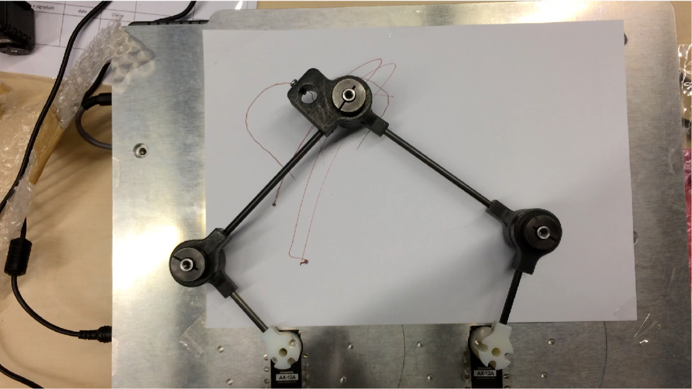

#########################################################
système 5 barres de dessin robotisé avec Raspberry Pi et ROS2
#########################################################

.. toctree::
   :maxdepth: 2

   p50s01_material_description
   p50s02_mechanical_description
   p50s03_urdf

=====================
Description du projet
=====================

.. Pour ce travail pratique, vous allez installer une plateforme robotique ROS2 sur un Raspberry Pi (Pi5) et documenter le projet.

L'objectif de ces travaux pratiques et de faire fonctionner la plateforme robotique, le système 5 barres avec ROS2 sur un Raspberry Pi (Pi5) et documenter le projet.
Le projet consiste donc à:

.. #. installer Ubuntu sur le Raspberry Pi, 
.. #. installer ROS2,
.. #. Tester et documenter les tests de l'installation système 

#. Décrire la plateforme mécanique
#. Décrire le matériel électronique, carte dynamixel avec les liens sur les documentations techniques (datasheets)
#. Créer la représentation mécanique du système 5 barres dans un fichier URDF
#. Visualiser le résultat avec RVIZ
#. Décrire la dynamique et donner les équations pour piloter la position de l'organe terminal du système 5 barres: comment 
#. Créer un package ROS2 pour contrôler le système 5 barres
#. Créer des tests et documenter les tests
#. Créer un code pour dessiner avec le système 5 barres
#. Tester en réel avec le système 5 barres
#. Créer un code de simulation pour le système 5 barres
#. Tester en simulation avec Gazebo et RViz

La documentation correspondra à un fork de ce projet et sera publiée sur votre github.
Dans ce projet un canevas de documentation est fourni. Vous devrez le compléter et le publier.
Vous soumettrez votre travail sous forme de push request à ce projet.

Vous serez évalué sur la qualité de la documentation de votre projet et le pilotage du système 5 barres réel.