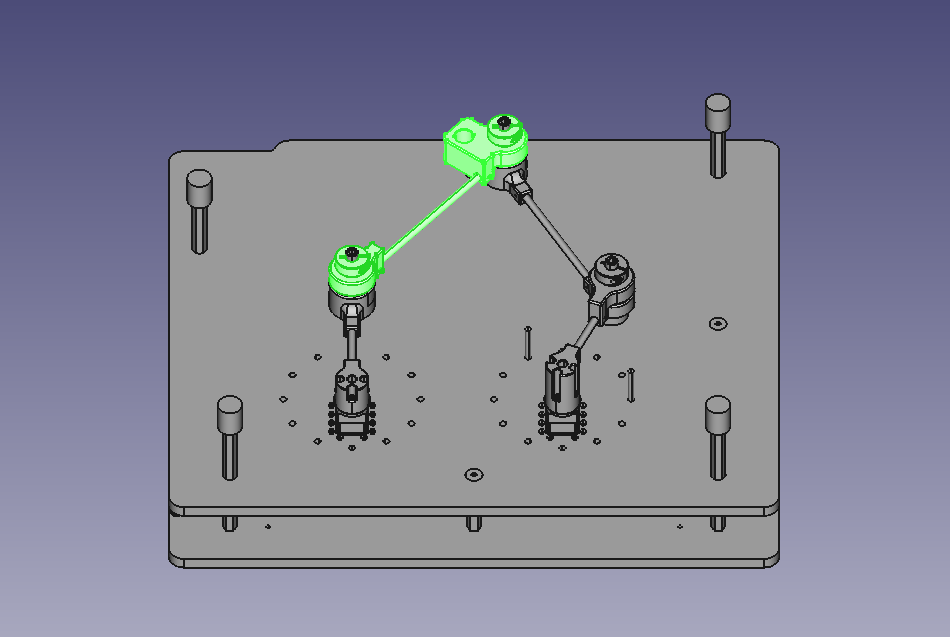

###################################################
 Génération de la description URDF du système 5 barres
###################################################

Nous allons utiliser le modèle 3D au format step conçu et réalisé par M. Olivier PICCIN pour générer la description URDF du système 5 barres.

Il s'agit d'un assemblage comportant 5 pièces principales :

  #. BATI_ASM: le bâti de la strucuture du système 5 barres avec les 2 moteurs pas à pas. Dans l'URDF nous allons le nommer ``base``.
  #. LINK1_ASM: le bras gauche du système 5 barres. Dans l'URDF nous allons le nommer ``link1``.
  #. LINK2_ASM: l'avant bras gauche du système 5 barres. Dans l'URDF nous allons le nommer ``link2``.
  #. LINK3_ASM: l'avant bras droit du système 5 barres. Dans l'URDF nous allons le nommer ``link3``.
  #. LINK4_ASM: le bras droit du système 5 barres. Dans l'URDF nous allons le nommer ``link4``.

:download:`maquette-5-barres_asm.stp <resources/cad/maquette-5-barres_asm.stp>`

Du point de vue URDF, nous aurons aussi besoin de définir l'outil de travail: le crayon et donc de le référencer par rapport à son support qui se trouve être sur l'avant bras gauche du pentographe (``link2``).

Dans un fichier URDF, les modèles 3D sont utilisés à partir de fichiers collada (extension .dae).
Il va donc falloir convertir notre modèle 3D au format step en un ensemble de 5 modèles 3D au format collada.

==================================
Extraction des modèles 3D en step
==================================

Pour extraire les modèles 3D au format step, vous pouvez utiliser le logiciel freecad.
   
   #. :download:`base.stp <resources/cad/base.stp>`
   #. :download:`link1.stp <resources/cad/link1.stp>`
   #. :download:`link2.stp <resources/cad/link2.stp>`
   #. :download:`link3.stp <resources/cad/link3.stp>`
   #. :download:`link4.stp <resources/cad/link4.stp>`

.. _five_bars_stoppers:

Les butées du bâti
==================

.. index::
   5 barres; butées
   5 barres; bâti

Le bâti comporte deux **butées** : deux petits plots de 4 × 35 × 4 mm qui limitent
mécaniquement la course des deux bras et les empêchent de se replier l'un sur l'autre.

Elles ont été **sorties du modèle du bâti** et sont maintenant fournies comme deux pièces
distinctes. Il y a donc deux versions du bâti, et il faut choisir en connaissance de cause :

.. list-table::
   :header-rows: 1
   :widths: 35 65

   * - Fichier
     - Contenu
   * - :download:`base.stp <resources/cad/base.stp>`
     - le bâti **sans** les butées — c'est la version de référence
   * - :download:`base_with_stoppers.stp <resources/cad/base_with_stoppers.stp>`
     - l'ancienne version, bâti **et** butées d'un seul tenant
   * - :download:`stopper_01.stp <resources/cad/stopper_01.stp>` |br|
       :download:`stopper_02.stp <resources/cad/stopper_02.stp>`
     - les deux butées, séparément

Les butées sont aussi disponibles directement en maillage, pour ceux qui veulent les
manipuler sans repasser par un modeleur :
:download:`stopper_01.stl <resources/cad/stopper_01.stl>` et
:download:`stopper_02.stl <resources/cad/stopper_02.stl>`,
ainsi que le bâti sans butées :download:`base.stl <resources/cad/base.stl>`.

.. note::

   Séparer les butées du bâti rend le modèle plus souple : on peut les déplacer pour changer
   le débattement autorisé, les supprimer pour étudier le mécanisme sans limite, ou les
   déclarer comme géométries de **collision** afin que le simulateur fasse respecter les
   butées au lieu de se contenter des bornes ``q1 ∈ [30°, 170°]`` et ``q4 ∈ [10°, 150°]``
   déclarées dans ``config/geometry.yaml``.

.. warning::

   **Ces butées ne font pour l'instant partie ni de l'URDF ni du modèle MuJoCo du projet
   ROS 2.** Les fichiers sont fournis pour pouvoir expérimenter, mais le modèle simulé
   utilise toujours le bâti sans butées et des bornes articulaires purement numériques.
   Leur intégration reste à faire.

   Attention aussi : ces maillages sortent du modeleur **en millimètres et dans le repère de
   l'assemblage CAO**. Avant de les utiliser dans un URDF ou un MJCF, il faut les ramener en
   **mètres** et dans le **repère du corps** porteur, comme le fait
   ``five_bars_description/tools/convert_cad.py`` pour les cinq pièces principales.

=====================================
Conversion des modèles 3D en collada
=====================================

Pour convertir les modèles 3D en collada (dae), vous pouvez utiliser le logiciel freecad.
   
   #. :download:`base.dae <resources/cad/base.dae>`
   #. :download:`link1.dae <resources/cad/link1.dae>`
   #. :download:`link2.dae <resources/cad/link2.dae>`
   #. :download:`link3.dae <resources/cad/link3.dae>`
   #. :download:`link4.dae <resources/cad/link4.dae>`

=========================
Création du fichier URDF
=========================

Dans un fichier URDF les modèles 3D sont référencés par des balises ``<mesh>``.